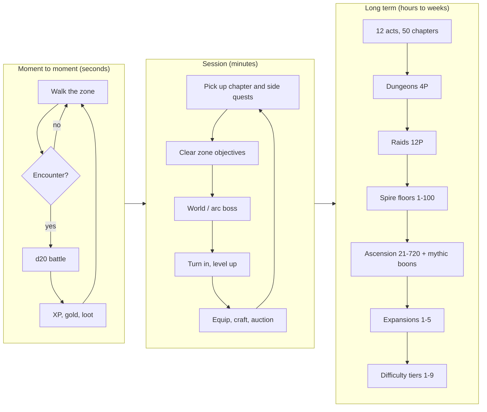

# GB Quest: Lanterns of Aelmoor — Game Design Document

| | |
|---|---|
| **Studio** | ArkansasIo |
| **Version** | 2.0.0 (build B2026.11.01) |
| **Genre** | Handheld-style MMORPG with d20 tabletop rules |
| **Platforms** | Web (single HTML file, windowed or full screen), desktop port (C++23/SDL2, in progress), Game Boy Color ROM (RGBDS, planned core) |
| **Players** | 1 (with AI companions), 4 (dungeon party), 12 (raid) |
| **Display** | 160×144 framebuffer. Game Boy, Game Boy Color and full-colour palettes, plus a 64-bit presentation mode (640×576, smoothed, lit) |

Companion documents: [ARCHITECTURE](ARCHITECTURE.md) · [UML](UML.md) · [STORY](STORY.md) · [CHARACTERS](CHARACTERS.md) · [CONTENT_CATALOG](CONTENT_CATALOG.md) · [WORLD_ATLAS](WORLD_ATLAS.md) · [AUDIO](AUDIO.md) · [GRAPHICS](GRAPHICS.md) · [MULTIPLAYER](MULTIPLAYER.md) · [BUILD](BUILD.md) · [CONTROLS](CONTROLS.md)

---

## 1. Vision

A whole MMORPG on a 160×144 screen: the d20 combat of a tabletop campaign, the zones, dungeons, raids and economy of a World of Warcraft-style MMO, and the act-and-chapter campaign of an action RPG. It is all original lore and runs from one file in a browser tab.

**Elevator pitch:** *the lanterns that keep the dark out of Aelmoor are going out one by one; rekindle them across 90 zones, from level 1 to level 720.*

### Pillars

1. **Real rules, tiny screen.** Every swing is a d20 roll against armour class. Saves, conditions, concentration, death saves and spell slots all behave the way a tabletop player expects.
2. **A world worth walking.** The map is a hand-painted continent, Dunia, connected by roads and sea lanes. Each zone has its own biome, weather, music, bosses and quests.
3. **Play alone or together.** AI companions fill a solo party. The same page doubles as a server, so friends who open it join your realm and take their own turns.
4. **Endless climb.** Class levels run 1–20. Ascension levels run 21–720, alongside 9 difficulty tiers, a 100-floor tower and 5 expansions.
5. **Authentic handheld feel.** The game uses a 4-colour pipeline, a 4-channel chip synth and d-pad navigation, with modern options layered on top: GBC colour, a 64-bit video mode and 64-bit audio.

## 2. Core loops

## 3. Player character

- **Creation:** choose a name, 1 of 9 species, 1 of 12 classes (each with 2 subclasses) and 1 of 6 backgrounds. Ability scores use a priority array, then species bonuses apply. See [CHARACTERS](CHARACTERS.md).
- **Attributes:** STR, DEX, CON, INT, WIS and CHA (5e) plus LCK (crit range, loot), WIL (save bonus, resist) and SPD (initiative, flee).
- **Substats** come from gear affixes and ascension points: crit chance, crit damage, haste, lifesteal, armour pen, spell power, resist, gold find, magic find, thorns, dodge and regen.
- **Levels 1–20** follow class progression: features, an ability score increase or feat at 4/8/12/16/19, and spell slots (full, half or pact casters).
- **Ascension, levels 21–720:** +1 attribute and +2 substat points per level, and a mythic boon every 50 levels.
- **Companions:** every new hero starts with BRAM (warden) or ESME (chaplain). Hired adventurers fill the 4- and 12-player modes.

## 4. Combat

Turn-based and initiative ordered, following the 5e action economy (action, bonus action, movement abstracted to range bands).

| Element | Implementation |
|---|---|
| Attack | d20 + ability mod + proficiency (+ magic bonus) vs AC; natural 20 crits (crit range widened by LCK), natural 1 misses |
| Advantage | roll 2d20, keep the high or low; sources include conditions, flanking buffs and species traits |
| Saving throws | DC 8 + proficiency + casting mod; Legendary Resistance on bosses |
| Damage | 13 types; resistance, vulnerability and immunity; massive-damage rule |
| Conditions | 20 (blinded, charmed, frightened, grappled, paralyzed, poisoned, prone, restrained, stunned, unconscious and more) |
| Buffs/debuffs | 30 timed effects that stack by source |
| Death | 0 HP means unconscious; death saves (3 successes stabilise, 3 failures kill); a full party wipe leaves you a ghost who runs back to your body |
| Threat | tanks generate extra threat, and AI foes target by threat and opportunity |
| Bosses | multi-phase (enrage, summon, shield, curse, reflect, regen, AOE, frenzy), legendary actions, recharge abilities |
| Auto-battle | SELECT toggles AI control for the whole party |

The battle engine is host-authoritative. In multiplayer, the host runs every roll and remote players only send their chosen action (see [MULTIPLAYER](MULTIPLAYER.md)).

## 5. World

- **Dunia**, the continent of Aelmoor, has 3 landmasses: North Karra, South Karra and the West Isles. There are 28 regions (13 base, 15 expansion) split into **90 zones** across **9 biomes** and 36 sub-biomes. See [WORLD_ATLAS](WORLD_ATLAS.md).
- **Ardenhold** is the capital hub. It holds the vendor, inn, trainer, auction house, mail, bank, guild hall, honor quartermaster, LFG board, portal, stable and arena.
- **Travel:** walk zone edges along carved roads, take ships between continents, use waypoint shrines for fast travel, or use the hearthstone.
- **The world map** (SELECT) has three zoom levels: a continent overview, a scrolling detail map, and a zone tile view. Roads appear as dotted lines and sea lanes as blue dashes. The **Atlas** (M) opens the full interactive map with search, layers, details and a route planner.
- **Weather and time:** each biome has its own weather. In 64-bit video mode, a day/night cycle runs (one in-game day = 24 real minutes) with lantern lighting.

## 6. Content scale

| Content | Count |
|---|---|
| Zones / regions / biomes | 90 / 28 / 9 |
| Creatures | 400 (14 families × subtypes × 7 elemental variants + elites) |
| Bosses | 350 (12 arc, 177 world, 66 dungeon, 45 raid, 30 trial, 20 tower) |
| Dungeons / raids / trials | 22 / 9 / 6 |
| Tower | 100 floors |
| Story | prologue, 12 acts, 50 chapters, 6 generated side quests per zone |
| Spells | 59 across 8 schools |
| Sound | 103 chip SFX + 8 64-bit-only SFX, 24 music tracks in two arrangements |

Full lists are in [CONTENT_CATALOG](CONTENT_CATALOG.md).

## 7. Progression and economy

- **XP:** XP comes from monsters (by challenge rating and level), quests and discoveries. The curve is in `xpForLevel()`, and the sample table is in [CHARACTERS](CHARACTERS.md).
- **Loot:** rarities run poor → common → uncommon → rare → epic → legendary. Items get +1/+2/+3 bonuses and Diablo-style affixes. Need/greed rolls apply in groups.
- **Gold sinks:** training, mounts, inn rests, crafting reagents, auction house purchases and vendor gear.
- **Professions:** herbalism (biome herbs), alchemy, fishing (timing minigame) and cooking.
- **Reputation:** 5 factions (Lantern Pact, Sand Nomads, Stonekin, Thorn Court, Silverhaven) unlock vendors and titles.
- **PvP:** an arena with honor and rating.
- **Achievements:** 36.

## 8. Difficulty

Nine tiers from **Story** to **Apocalypse** scale monster level, HP, damage, XP and loot. They apply to the open world, dungeons, raids, trials and the tower, and are chosen at the LFG board or in settings.

## 9. Multiplayer

- **Modes:** 1 player with AI companions, 4-player dungeon parties, and 12-player raids. Empty slots are filled by AI adventurers.
- **Presence:** players who open the same page appear on the map in real time, with chat channels (say, trade, LFG, guild, emote).
- **Built-in host server:** any player can host. Guests join the host's battles and take their own turns, while the host stays authoritative.
- **Realm leaderboard:** a shared database of heroes.
- **Simulated realm:** NPC players walk the zones and chat, so the world feels populated when nobody else is online.

## 10. Presentation

| Layer | Game Boy mode | 64-bit mode |
|---|---|---|
| Resolution | 160×144 | 640×576 (Scale4x) |
| Colour | DMG 4-shade, GBC per-sprite 4-colour, or full colour | full colour, saturation and contrast grade |
| Lighting | none | day/night ambient, player lantern, glowing points of interest, dark dungeons, bloom, vignette |
| Audio | 4-channel APU-style synth (2 pulse, wave, noise) | stereo, 8 voices, reverb, echo, compressor, synthesized orchestra and drum kit |

Window builds: the handheld frame (`dist/gbquest.html`) and the full-screen window (`dist/gbquest-fullscreen.html`), which has a full-screen toggle, integer pixel scaling, an overlay pad and an overlay chat.

## 11. UX principles

- Every screen is usable with the d-pad plus A and B. B always goes back.
- Text speed is adjustable, and A/B can be swapped.
- Saves have 3 slots plus autosave, with a Continue option on the title screen.
- Settings: palette, video, tiles, art, audio, volumes, brightness, contrast, text speed, weather, auto-battle and difficulty. The sound test covers both audio engines.

## 12. Legal and content boundaries

All names, lore, characters, maps and art direction are original. The mechanics model the SRD 5.1 (CC-BY-4.0, see [SRD_ATTRIBUTION](SRD_ATTRIBUTION.md)). World of Warcraft and Diablo are feature references only. None of their names, maps, text, art or audio are reproduced.

## 13. Roadmap

| Milestone | Status |
|---|---|
| Web game v2 (everything above) | shipped |
| Interactive atlas and in-game roads | shipped |
| 64-bit video and audio modes, HD asset atlases | shipped |
| Full-screen window build | shipped |
| C++23 + SDL2 desktop port (`desktop/`) | scaffold in CI; systems porting in progress |
| Game Boy Color ROM (RGBDS), core subset | planned |
| Dedicated server (Node) for persistent realms | planned |
