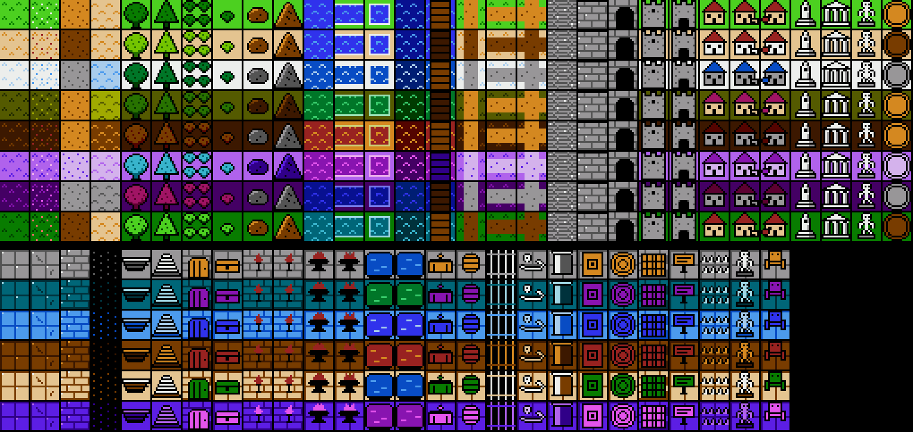

# NES CLASSIC art mode

An art mode in the style of 1980s NES role-playing games: flat colour, hard black outlines and simple pixel patterns.
Choose it in **SETTINGS > ART > NES CLASSIC**.



| What | Files | Notes |
|---|---|---|
| Overworld tiles | `assets/gt_n8<palette>_<key>.png` (600) | 8 palettes x 75 tiles: grass, flowers, sand, trees, pines, forest, rocks, mountains, 16 shorelines x 2 wave frames, 16 road joins, bridges, town walls, castle keeps, houses, inns, shops, shrines, temples, statues, arenas |
| Dungeon tiles | `assets/gd_n8<theme>_<key>.png` (156) | 6 themes x 26 tiles: floors, walls, stairs, doors, chests, torches, braziers, pools, altars, thrones, seals, spikes... |
| Characters, monsters, items | the RETRO 8-BIT sprites | heroes for all 27 jobs, townsfolk, monsters, bosses, item icons and town buildings |

**Palettes** (by biome): green (default), sand (desert, badlands, savanna, oasis), snow, swamp (marsh, mushroom),
lava (volcanic), mystic (crystal, aether, sky), dark (dusk, corruption, ruins) and jungle (jungle, deep forest).
Dungeon themes: dungeon, crypt, ice, lava, temple, void.

**Rules the tiles follow** (checked by `tools/gen_nes8.py` and `tests/nes-classic-tiles.test.js`): every colour comes
from the NES console's 64-colour palette, and each 16x16 tile uses at most four colours, the limit NES background
tiles had. Trees are tiles, so the painted tree overlays used by the other modes are off in this mode.

All of it is original: every tile is laid out pixel by pixel in the generator, and no art from any other game is used.

```
python tools/gen_nes8.py               # writes the 756 tiles into assets/
python tools/gen_nes8.py --sheet X     # also writes a contact sheet to X
```
