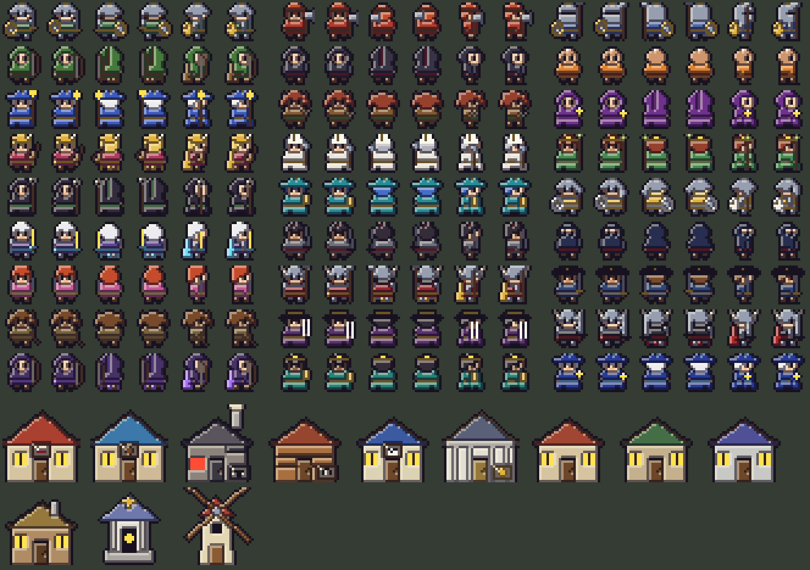

# RETRO 8-BIT heroes and buildings

Original sprites that complete the **RETRO 8-BIT** art mode (SETTINGS > ART). They are drawn from scratch by
`tools/gen_retro8_heroes.py` with the same materials, three-tone shading and ink outline as the rest of the
8-bit set (`tools/gen_retro8.py`). No third-party sprites are read or copied.



| Set | Files | Size | Used for |
|---|---|---|---|
| Hero walkers | `assets/r8h_<job>_<down/up/side><0/1>.png` (162) | 16x16 | Your hero, party followers and other players, one design per job, two steps in each direction (left mirrors the side view) |
| Town buildings | `assets/r8bld_<kind>.png` (12) | 32x32 | Inn, store, smithy, stable, post office, bank, shrine, windmill and four houses in every town and village |

Each job has its own look: armour or robes, headgear (helms, hoods, wizard hats, a mitre, a tricorn, a top hat,
horned helms), and its weapon (swords, a katana, spears, bows, staves, orbs, books, a lute, puppet strings).

```
python tools/gen_retro8_heroes.py             # writes the PNGs into assets/
python tools/gen_retro8_heroes.py --sheet X   # also writes a contact sheet to X
```
