# UML and design diagrams

All diagrams are Mermaid, so GitHub renders them inline. The names match the source.

## 1. Component diagram

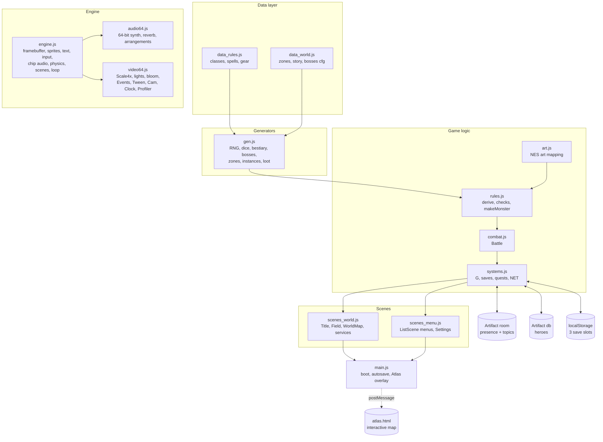

## 2. Class diagram: scenes

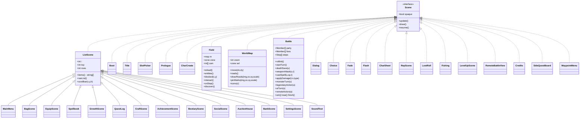

## 3. Class diagram: domain model

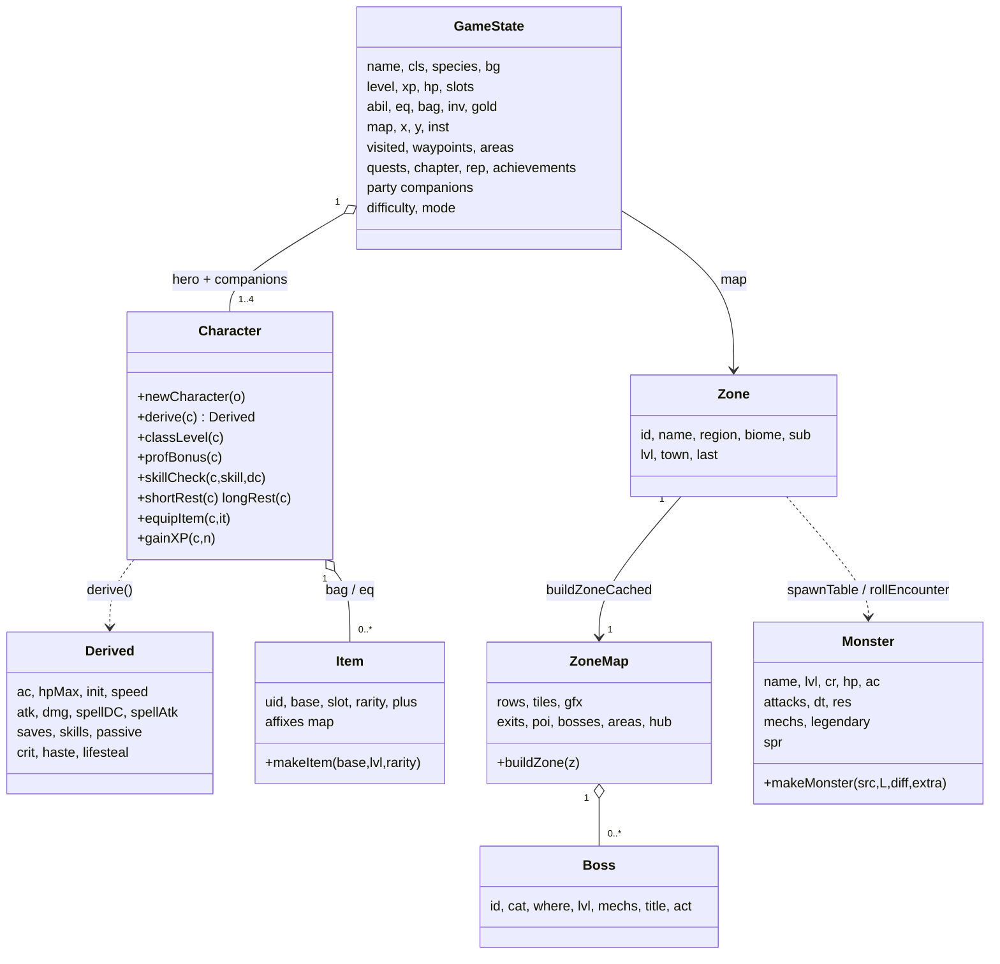

## 4. State machine: scene flow

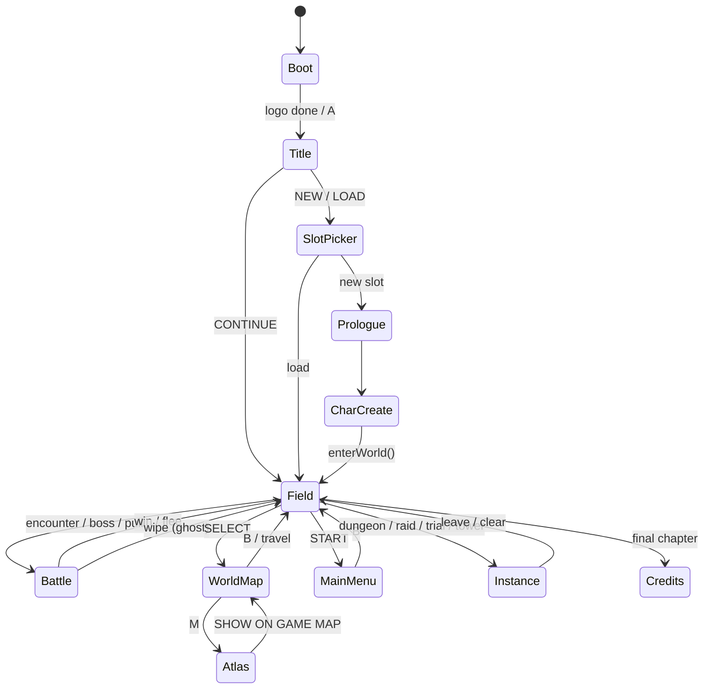

## 5. State machine: a battle turn

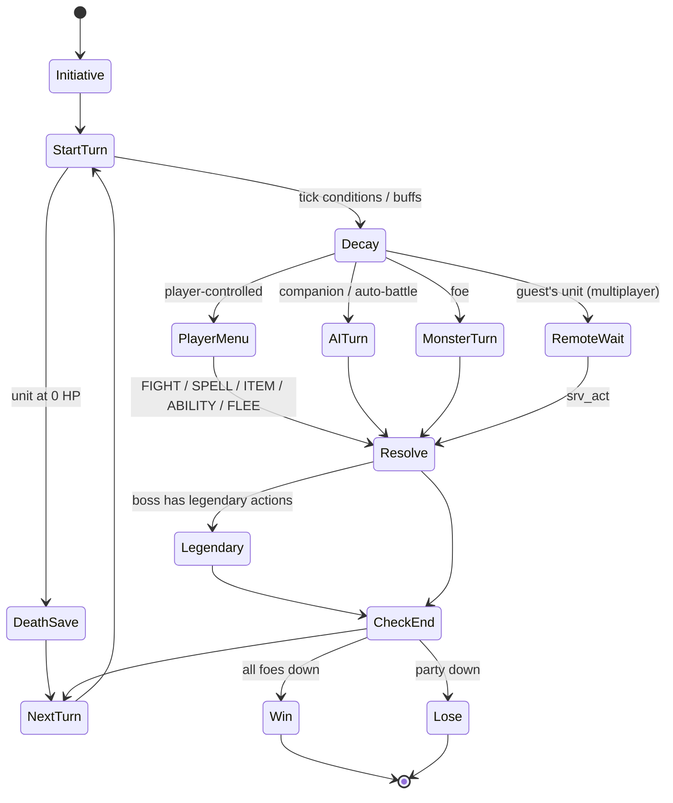

## 6. Sequence: weapon attack

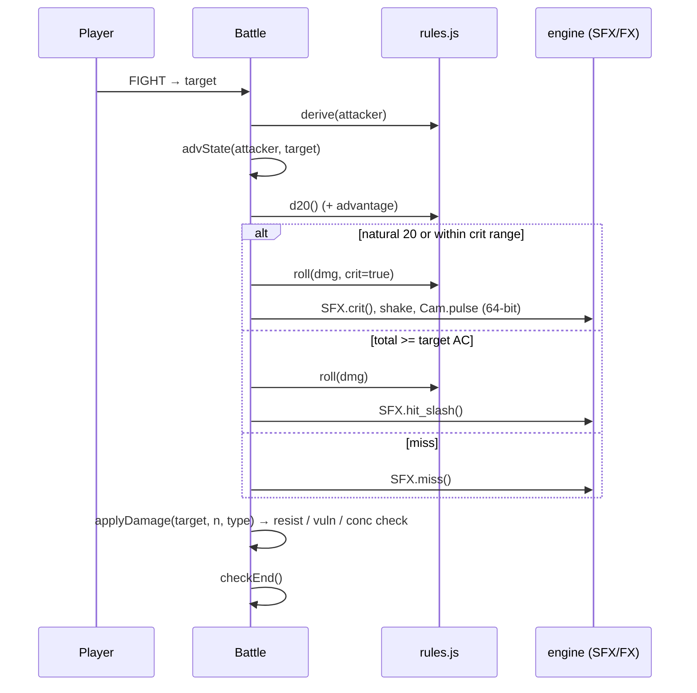

## 7. Sequence: multiplayer host battle

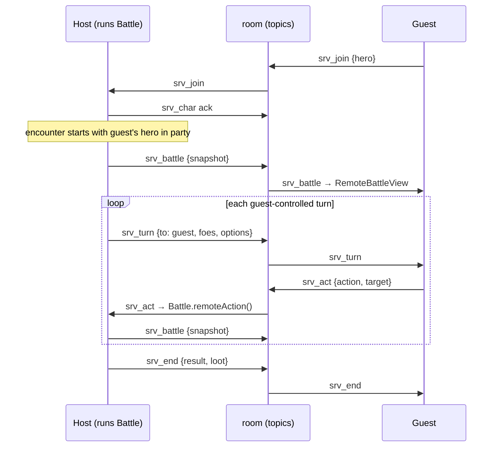

## 8. Sequence: save and load

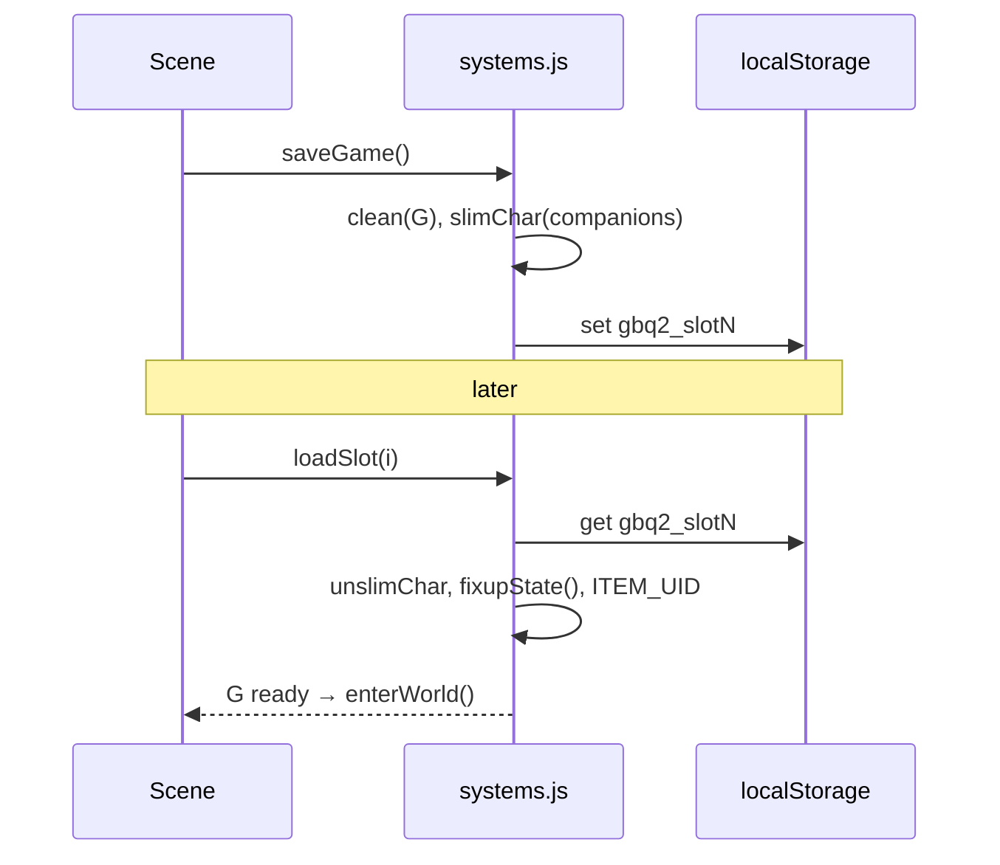

## 9. Sequence: 64-bit frame

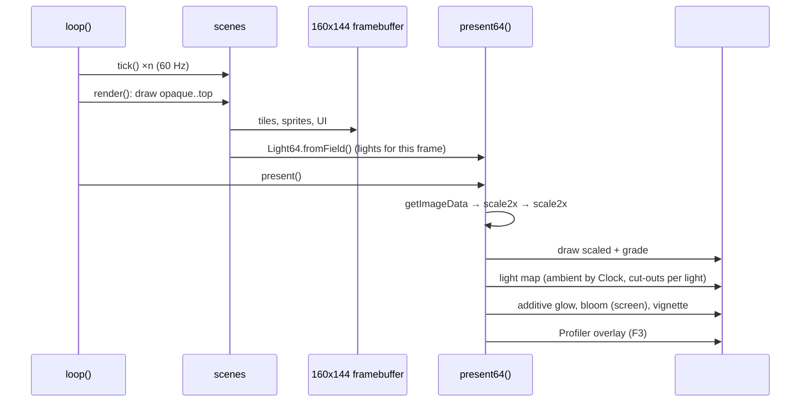

## 10. Activity: world generation

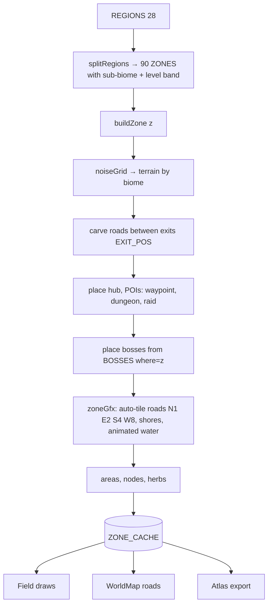

## 11. Deployment

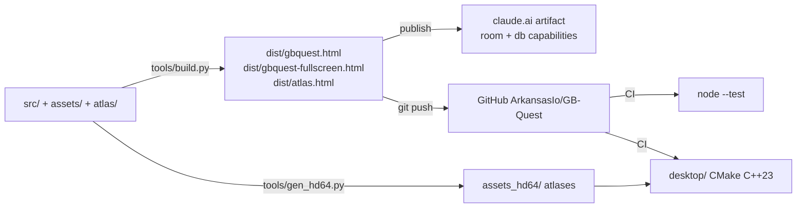
